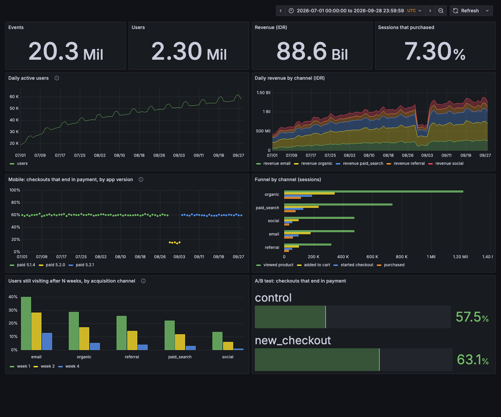

# Event analytics with ClickHouse

[](https://github.com/dinulimann/event-analytics/actions/workflows/ci.yml)

Product analytics you own, in the style of Google Analytics or Mixpanel: a collector API takes tracking events
from a web shop or app, ClickHouse stores them, and a Grafana dashboard answers the usual
questions: active users, the funnel, retention by channel, revenue, an A/B test, and an app
release that broke payments.

The demo holds **20.3 million events** (90 days, 2.3 million users) of a fictional shop.
The data was generated with **known answers**, so every number on the dashboard is checked
against the truth, not eyeballed.



```
web / app ──HTTP──► collector (FastAPI) ──► ClickHouse ──► Grafana
   batches of        validates each event,    events (ReplacingMergeTree)
   up to 500         rejects with a reason,   events_rejected
   events            answers after the write  daily_users (materialized view)
```

## What the dashboard shows

The generator planted three patterns. The queries had to find them, and the numbers had to match
exactly ([`scripts/verify.py`](scripts/verify.py), 13 checks).

| Question | What the data says | Query |
|---|---|---|
| Did the new checkout work? | Checkouts that end in payment: **57.5% → 63.1%** with `new_checkout` | sessions, `max(event_name = …)` |
| Why did revenue dip in early September? | Mobile app **5.2.0** (30 Aug–3 Sep): only **15%** of mobile checkouts were paid, against 60% before and after; 5.2.1 fixed it | the same, by `app_version` |
| Which channel brings users who come back? | Week-1 return rate: email **40%**, organic 29%, social **14%** | `retention()` per user, by first week |
| Where do sessions drop off? | Funnel per channel: product view → cart → checkout → purchase | `windowFunnel(3600)` per session |

The incident is the kind of thing this setup is for. Revenue fell for five days, and only splitting checkout
success by app version shows that it was one release and one platform, not demand.

## Correct under real-world input

The collector is the part that must not lie. [`scripts/loadtest.py`](scripts/loadtest.py) sends
200,000 events with the problems real clients cause, then checks what ClickHouse stored:

```
sent 209,800 events in 1,049 requests (49 retried batches) in 14.8s: 14,167 events/s;
request latency p50 468 ms, p95 551 ms, p99 582 ms
valid events sent: 196,046 unique; stored rows 198,980 (before merge), unique ids 196,046, rows with FINAL 196,046
invalid events sent: 4,164 (including copies in retried batches); in events_rejected: 4,164
RESULT: every valid event stored exactly once, every invalid one rejected
```

- **Retries do not double count.** A client that times out sends the same batch again with the
  same `event_id`s. The table is a `ReplacingMergeTree` keyed on them: copies collapse when parts
  merge, and until then exact counts use `FINAL` or `uniqExact(event_id)`. The load test checks both.
- **Bad events are kept, not dropped.** Unknown event names, missing fields, clocks more than
  5 minutes ahead, events older than 7 days, and revenue on a non-purchase event are each
  stored in `events_rejected` with the reason. One bad event does not fail its batch.
- **A 202 means stored.** Inserts use `async_insert` with `wait_for_async_insert`. ClickHouse
  batches many small requests into one write, and the collector answers only after that write. That
  is most of the ~470 ms latency. Answering before the write would be faster, but an event could be
  lost on a crash, so this setup chooses durability. If ClickHouse is down, the client gets a 503 and retries.

## Speed

On a laptop with Docker limited to 4 GB RAM. ClickHouse gets half of that and 2 threads per query
([`clickhouse/low-memory.xml`](clickhouse/low-memory.xml)):

20,300,461 events, **513 MB on disk**:

| Query | Median | Rows read |
|---|---:|---:|
| Events by type | 51 ms | 20.5 M |
| Revenue by channel | 28 ms | 3.3 M |
| Checkout → purchase by variant | 119 ms | 4.7 M |
| Mobile payment rate by app version | 149 ms | 4.7 M |
| Top products | 106 ms | 20.3 M |
| Daily active users (from the materialized view) | 314 ms | 4 K |
| Funnel by channel (per session, 4.3 M sessions) | 1.6 s | 13.4 M |
| 4-week retention by channel (per user, 2.3 M users) | 2.1 s | 33.9 M |

Full table: [docs/benchmark.md](docs/benchmark.md).

**Storage.** Half of the 513 MB is `event_id`. Random UUIDs cannot be compressed, and deduplication
needs them. `Delta` + `ZSTD` codecs on timestamps and IDs cut the remaining columns by 29%
(292 → 208 MB) compared with the default.

**Memory.** With several dashboard panels running at once, the per-session funnel first failed with
`memory limit exceeded`. Large `GROUP BY`s and sorts now spill to disk above 250 MB, so the dashboard gets slower
under load instead of breaking.

## Run it

```bash
python -m venv .venv && .venv/bin/pip install -r requirements.txt
docker compose up -d --build --wait     # ClickHouse :8124, collector :8130, Grafana :3002
.venv/bin/python scripts/generate.py    # 20 M events in about a minute (writes data/truth.json)
.venv/bin/python scripts/verify.py      # every query vs the ground truth
.venv/bin/python scripts/loadtest.py    # collector under load, with retries and bad events
.venv/bin/python scripts/benchmark.py
.venv/bin/pytest                        # 18 tests
```

Dashboard: http://localhost:3002/d/shop-events (anonymous view, or admin/admin).
Send your own event:

```bash
curl -X POST localhost:8130/v1/events -H 'content-type: application/json' -d '{"events": [{
  "event_id": "6f1c3a52-2b1e-4c55-9a0e-3f7c1d2b9a10", "event_name": "page_view", "user_id": "u1",
  "session_id": "s1", "ts": "'"$(date -u +%Y-%m-%dT%H:%M:%SZ)"'", "page": "/", "device": "mobile", "country": "ID"}]}'
# {"accepted":1,"rejected":0}
```

CI runs the unit tests, then starts the whole stack. It generates 100,000 users, verifies every query
against the truth, load-tests the collector, verifies again (the load test cleans up after itself),
and checks that Grafana can query ClickHouse.

## Layout

```
api/collector.py         validation, rejection reasons, durable inserts
clickhouse/schema.sql    events, events_rejected, daily_users + materialized view, codecs
analytics/queries.py     the analytics SQL, shared by verify, benchmark and the dashboard
scripts/generate.py      vectorised generator with planted patterns and a ground-truth file
scripts/verify.py        queries vs ground truth
scripts/loadtest.py      throughput, retries, invalid events, exactly-once check
grafana/                 provisioned datasource and dashboard
```

## Not covered

- One ClickHouse node. Replication and sharding are configuration on top of the same schema, but they are not done here.
- No identity stitching: an anonymous visitor who later logs in counts as two users.
- The collector has no authentication or rate limiting. A public endpoint needs both.
- The data is generated. The patterns are planted to show that the analysis finds them, not to claim anything about a real shop.
